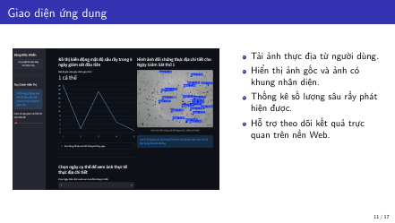
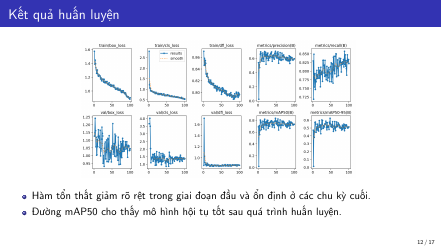
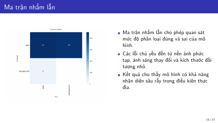

# Hệ thống nhận diện và đếm số lượng sâu rầy ở ruộng lúa

Đồ án đa ngành – Khoa Khoa học và Kỹ thuật Máy tính, Trường Đại học Bách khoa – ĐHQG TP.HCM (05/2026).
Hệ thống dùng **YOLOv8s** để phát hiện và đếm sâu rầy trong ảnh ruộng lúa (Đồng Tháp), kèm dashboard **Streamlit** theo dõi mật độ theo ngày.

**GVHD:** Trần Nguyễn Minh Duy

| Thành viên | MSSV |
|---|---|
| Nguyễn Thế Mãnh | 2211990 |
| Trần Hữu Nam | 2312196 |
| Nguyễn Minh Quân | 2312837 |
| Nguyễn Đại Vinh | 2053589 |

## Kiến trúc

```
Ảnh thực địa ──► Backend FastAPI + YOLOv8s (Google Colab, GPU) ──ngrok──► Dashboard Streamlit (máy cá nhân)
```

Backend quét 100 ảnh kiểm thử, đếm sâu rầy bằng `best.pt`, vẽ khung nhận diện rồi trả JSON (`history` + ảnh base64) qua endpoint `GET /sync_cloud_dashboard`. Dashboard gọi endpoint này và vẽ biểu đồ.

## Cấu trúc repo

```
.
├── notebooks/
│   ├── 01_train_yolov8s.ipynb     # Huấn luyện mô hình (Colab)
│   └── 02_backend_server.ipynb    # Backend FastAPI + ngrok (Colab)
├── app/
│   ├── app.py                     # Dashboard Streamlit
│   └── requirements.txt
├── docs/
│   ├── report.pdf                 # Báo cáo cuối kỳ
│   ├── slides.pdf                 # Slide thuyết trình
│   └── images/
├── .gitignore
└── README.md
```

## Chạy nhanh

### Bước 1 – Backend trên Colab
1. Mở `notebooks/02_backend_server.ipynb` trên Google Colab, chọn **Runtime → Change runtime type → T4 GPU**.
2. Thêm ngrok authtoken (lấy tại <https://dashboard.ngrok.com>): biểu tượng 🔑 **Secrets** → tên `NGROK_AUTH_TOKEN` → bật *Notebook access*. (Nếu không có secret, notebook sẽ hỏi bạn dán token.)
3. **Runtime → Run all**. Notebook tự tải `best.pt` và 100 ảnh kiểm thử từ Google Drive (công khai, không cần đăng nhập).
4. Cuối cùng notebook in ra đường link dạng `https://xxxx.ngrok-free.app/sync_cloud_dashboard` → copy lại.

### Bước 2 – Dashboard trên máy cá nhân
```bash
cd app
pip install -r requirements.txt
streamlit run app.py
```
Dán link ở bước 1 vào ô **API URL** ở thanh bên (hoặc đặt biến môi trường `API_URL`), rồi bấm **Truy Xuất Dữ Liệu Máy Chủ đám mây**.

> Link ngrok bản miễn phí đổi sau mỗi lần chạy Colab, nên phải dán lại link mới.

## Huấn luyện lại mô hình

Mở `notebooks/01_train_yolov8s.ipynb` trên Colab. Dataset cần đặt tại `MyDrive/Dataset` theo cấu trúc YOLO, một lớp `pest`:

```
Dataset/
├── images/{train,val,test}/
└── labels/{train,val,test}/
```

Cấu hình: `yolov8s.pt`, 100 epochs, `imgsz=960`, `batch=16`. Trọng số tốt nhất lưu ở `runs/detect/train*/weights/best.pt`.
Khi suy luận, backend dùng `imgsz=960, conf=0.45, iou=0.4`.

## Dữ liệu & trọng số

| Thành phần | Nơi lưu |
|---|---|
| `best.pt` | [Google Drive](https://drive.google.com/uc?id=1_r7_KokjECzxu3aoV9Rq4EhMF6SEfE3K) |
| 100 ảnh kiểm thử | [Google Drive](https://drive.google.com/uc?id=1RApWy6-sPhaZItBUDD9xjQT8iF-CGNfv) |
| Dataset huấn luyện (~1000 ảnh: 700 train / 200 val / 100 test) | Do GVHD cung cấp, không đưa lên repo |

## Kết quả

| Chỉ số | Giá trị |
|---|---|
| mAP50 | 83.2% |
| Recall | 77.2% |
| Precision | 72.2% |
| Thời gian suy luận | 7.8 ms/ảnh (Tesla T4) |





Chi tiết xem [báo cáo](docs/report.pdf) và [slide](docs/slides.pdf).

## Tài liệu tham khảo
Ultralytics YOLOv8, FastAPI, Streamlit, ngrok – danh sách đầy đủ trong [báo cáo](docs/report.pdf).
